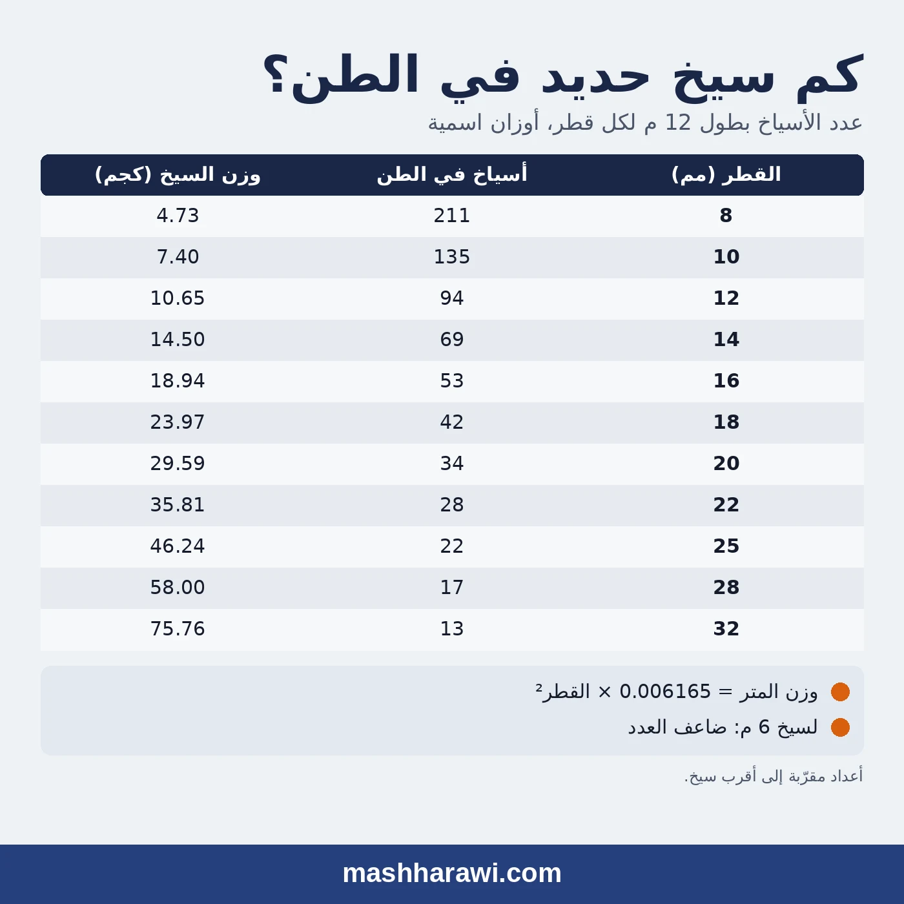

**الجواب المختصر:** الطن من حديد التسليح بأسياخ طولها 12 متراً فيه حوالي **94 سيخاً من قطر 12**، و**69 سيخاً من قطر 14**، و**53 سيخاً من قطر 16**. العدد يعتمد على القطر وطول السيخ فقط، والجدول التالي يعطيه لكل الأقطار.

الطلبية تُكتب بالأطنان، والموقع يحتاج أسياخاً. ولهذا يتكرر السؤال نفسه في كل مشروع: كم سيخاً في الطن؟

{: style="filter:none"}

## جدول عدد الأسياخ في الطن

| القطر (مم) | عدد الأسياخ في الطن (سيخ 12 م) | عدد الأسياخ في الطن (سيخ 6 م) | وزن السيخ 12 م (كجم) |
|:---:|:---:|:---:|:---:|
| 8 | 211 | 422 | 4.73 |
| 10 | 135 | 270 | 7.40 |
| 12 | 94 | 188 | 10.65 |
| 14 | 69 | 138 | 14.50 |
| 16 | 53 | 106 | 18.94 |
| 18 | 42 | 83 | 23.97 |
| 20 | 34 | 68 | 29.59 |
| 22 | 28 | 56 | 35.81 |
| 25 | 22 | 43 | 46.24 |
| 28 | 17 | 34 | 58.00 |
| 32 | 13 | 26 | 75.76 |

الأعداد اسمية ومقرّبة إلى أقرب سيخ. وطول 12 متراً هو الطول المعتاد في السوق السعودي، وهو ما يسميه كثيرون «السيخ أبو 12».

## أسئلة متكررة

### كم سيخ 12 في الطن؟

حوالي **94 سيخاً** بطول 12 م. وزن السيخ الواحد 10.65 كجم.

### كم سيخ 14 في الطن؟

حوالي **69 سيخاً** بطول 12 م. وزن السيخ الواحد 14.50 كجم.

### كم سيخ 16 في الطن؟

حوالي **53 سيخاً** بطول 12 م (52.8 بالضبط). وزن السيخ الواحد 18.94 كجم.

### كم سيخ 10 و8 في الطن؟

قطر 10: حوالي **135 سيخاً**. قطر 8: حوالي **211 سيخاً**. كلاهما بطول 12 م.

### كم سيخ 20 و25 و32 في الطن؟

قطر 20: حوالي **34 سيخاً**. قطر 25: حوالي **22 سيخاً**. قطر 32: حوالي **13 سيخاً**.

### وإذا كان طول السيخ 6 أمتار؟

ضاعف العدد. الطن من قطر 16 بطول 6 م فيه حوالي 106 أسياخ. ولأي طول آخر استخدم المعادلة في القسم التالي.

### كم وزن السيخ 12 متر؟

يختلف حسب القطر: 10.65 كجم لقطر 12، و14.50 كجم لقطر 14، و18.94 كجم لقطر 16. والأوزان لكل متر ولكل الأقطار في [جدول أوزان حديد التسليح](/writing/rebar-weight-table/).

## من الأطنان إلى الأسياخ

عدد الأسياخ = الكمية بالكيلوجرام ÷ وزن السيخ الواحد

ووزن السيخ = 0.006165 × القطر² × الطول بالمتر.

مثال: طلبية 25 طناً من حديد 16 مم بأسياخ 12 م

- وزن السيخ: 0.006165 × 16 × 16 × 12 = 18.94 كجم
- عدد الأسياخ: 25,000 ÷ 18.94 = حوالي 1,320 سيخاً

## من الأسياخ إلى الأطنان

الوزن = عدد الأسياخ × وزن السيخ الواحد

مثال: يحتاج الموقع 500 سيخ من حديد 12 مم بطول 12 م

- وزن السيخ: 0.006165 × 12 × 12 × 12 = 10.65 كجم
- الوزن الكلي: 500 × 10.65 = 5,325 كجم، أي حوالي 5.33 طن

## لماذا يختلف العدد الفعلي عن الحساب؟

الحساب يستخدم الوزن الاسمي. المصنع يورّد ضمن السماحية المسموحة في المواصفة، فقد يكون الوزن الفعلي للسيخ أخف أو أثقل قليلاً من الاسمي.

فلو جاء الحديد أخف من الاسمي بـ 3%، فإن الطن من 16 مم يحتوي حوالي 54.4 سيخاً بدل 52.8. والفرق على طلبية 25 طناً حوالي 40 سيخاً. لهذا يجب أن يحدد العقد هل البيع بالوزن الفعلي على الميزان أم بالوزن الاسمي، وما السماحية المقبولة. كتبت عن هذه النقطة في مقال [السماحية في الوزن مصطلح تجاري لا فني](/writing/weight-tolerance/).

## احسبها مباشرة

[حاسبة وزن حديد التسليح](/ar/tools/rebar-weight/) تحوّل من الأطنان إلى الأسياخ والعكس لأي قطر وطول، وتجمع طلبية بعدة أقطار في جدول واحد. ولحساب كمية حديد سقف كامل من المخطط، انظر [كيف تحسب كمية حديد التسليح في السقف](/writing/slab-rebar-quantity/).
