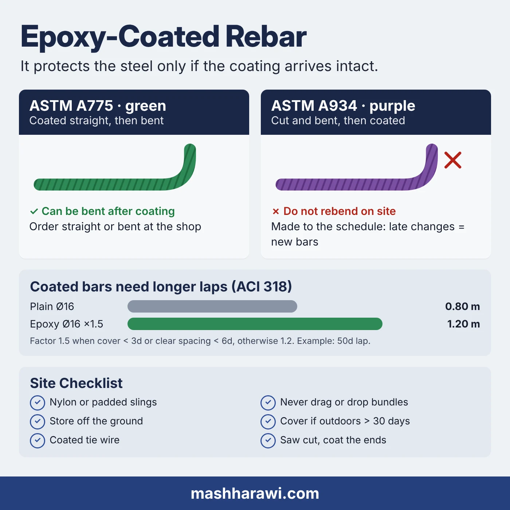

Epoxy-coated rebar is ordinary rebar with a thin layer of fusion-bonded epoxy on the outside. The steel does the structural work. The coating keeps chlorides and moisture away from the steel so it rusts later, or not at all.

The coating only works if it reaches the concrete intact. Most of what goes wrong with epoxy-coated bars happens between the coating line and the pour, not in the factory.

## Where it is specified in Saudi Arabia

Rebar corrodes when chlorides reach it through the concrete. In Saudi Arabia that usually means one of these:

- **Coastal projects** on the Red Sea and the Gulf: Jeddah, Rabigh, Yanbu, Jubail, Dammam and the developments between them.
- **Foundations, piles and retaining walls** in contact with seawater or saline groundwater, including sabkha ground near the coast.
- **Water structures**: desalination plants, sewage treatment plants, tanks and other wet underground structures.
- **Industrial plants** with chemical exposure, such as power plants and process facilities.

Whether to use coated bars, and in which elements, is the designer's decision. It is often limited to the parts of the structure that see the exposure, such as the foundations and the splash zone, with plain bars above. Read the drawings and the specification element by element before you price the job.

## ASTM A775 or ASTM A934: green or purple

There are two common standards for epoxy-coated rebar, and they are not interchangeable.

| | ASTM A775 | ASTM A934 |
|---|---|---|
| Coated when | Straight, before bending | After the bars are cut and bent |
| Typical colour | Green | Purple or grey |
| Can it be bent after coating? | Yes, with care | No: bending cracks the coating |

The practical rule is simple. **Only A775 bars may be bent after coating.** If an A934 bar is the wrong shape, bending it on site will crack the coating and it should be replaced, not "fixed" with a hammer.

That makes the bar bending schedule more important than usual. Bars coated to A934 are made to the schedule, so a late change means new bars, not a quick rebend. If the drawings are still moving, say so before the order is placed.

## Coated bars need longer laps

This is the part that surprises buyers. The coating reduces the bond between the bar and the concrete, so the code asks for more length to transfer the same force.

ACI 318, which the Saudi Building Code SBC 304 follows for this, applies a coating factor to the development length of epoxy-coated bars:

- **1.5** where the concrete cover is less than 3 bar diameters or the clear spacing is less than 6 bar diameters.
- **1.2** for all other epoxy-coated bars.
- **1.0** for uncoated bars.

The product of the coating factor and the top-bar factor need not exceed 1.7.

Lap splices are worked out from the development length, so they grow by the same factor. In a typical slab or wall, where cover is well under 3 diameters, a lap that was 50 diameters with plain bars becomes about 75 diameters with coated bars.

Take a 16 mm bar. A 50d lap is 0.80 m; at 1.5 it becomes 1.20 m. That extra 0.40 m of steel at every lap is real tonnage, and it is coated tonnage. If the estimate was made from the plain-bar drawings, the quantity is short. The note on [cut lengths under BS 8666 and ACI 318](/writing/bs8666-vs-aci-cut-length/) shows how quickly small length changes add up across a schedule.

## Damage limits and repair

The coating is tough but thin. Older editions of A775 and A934 asked for most thickness readings to fall between 7 and 12 mils, roughly 175 to 300 µm. Check the edition your specification names for the current figures.

On site, the guidance from the US Epoxy Interest Group is a good working rule:

- A bar with **more than 2% of its surface damaged in any 0.3 m (1 ft) length** may be rejected at receiving and should be replaced before placing.
- Patched areas should not exceed **5% of the surface in any 0.3 m length**. Cut ends are counted separately.
- Repairs use the **two-part epoxy patching material** approved by the coating manufacturer, applied to clean steel and left to cure before the pour. Spray cans do not meet the standards.
- **Cut ends must be coated.** Every bar cut on site leaves bare steel at the end, and that is where corrosion starts.

The repair rules are another reason to order bars cut and bent to the schedule at the mill. Fewer site cuts means fewer bare ends and less patching.

## Handling and storage on site

Most coating damage comes from habits that are fine for plain rebar.

- **Lift with nylon or padded slings** and a spreader bar with several pick-up points. Never bare chains or wire rope.
- **Never drag bars** off the truck or across the ground, and do not drop bundles.
- **Store off the ground** on timber, and keep coated and plain bars apart so they are not mixed in the cage.
- **Cover bars that will sit outdoors** for more than about a month with an opaque sheet that does not trap condensation. Sunlight chalks and weakens the coating surface over time. Published guidance ranges from 30 days to 2 months, and the Saudi summer is a reason to stay at the short end.
- **Tie with coated wire**, usually PVC-coated, and use plastic or coated bar chairs.
- **Cut with a saw or shear**, never a torch, and coat the end the same day.
- During the pour, use vibrators with rubber or plastic heads and keep foot traffic on the mat to a minimum.

## What it costs

The price of the coating per tonne is only the visible part. A fair comparison between a plain-bar and a coated-bar estimate includes:

1. **The coating** itself, priced per tonne by size.
2. **Extra length** at laps and anchorages from the 1.2 or 1.5 factor.
3. **Lead time**, especially for A934 bars made to the schedule.
4. **Site handling**: padded slings, coated wire, covers and patching material.
5. **Rejected bars** if the handling is poor.

Items 2 and 5 are the ones that turn up later as variations. Price them at the start.

## What to send with a quotation request

To quote coated bars quickly, send:

- Sizes and tonnage, or the bar bending schedule.
- The coating standard: **ASTM A775** (bendable) or **ASTM A934** (bent before coating).
- Grade: Grade 60 or Grade 80.
- Whether the bars are straight 12 m or cut and bent to the schedule.
- The delivery city, the required date and how long the bars will be stored before the pour.

Al Rajhi Steel supplies epoxy-coated rebar from 10 to 32 mm in Grade 60 and Grade 80, cut to length, with test certificates, delivered across Saudi Arabia. The Jeddah plant is close to projects on the west coast. See the [rebar supply page](/rebar/) for details, or use the [rebar weight calculator](/tools/rebar-weight/) to turn a schedule into tonnes. A Chinese version of the supply notes is at [环氧涂层钢筋](/zh/epoxy-coated-rebar/).
