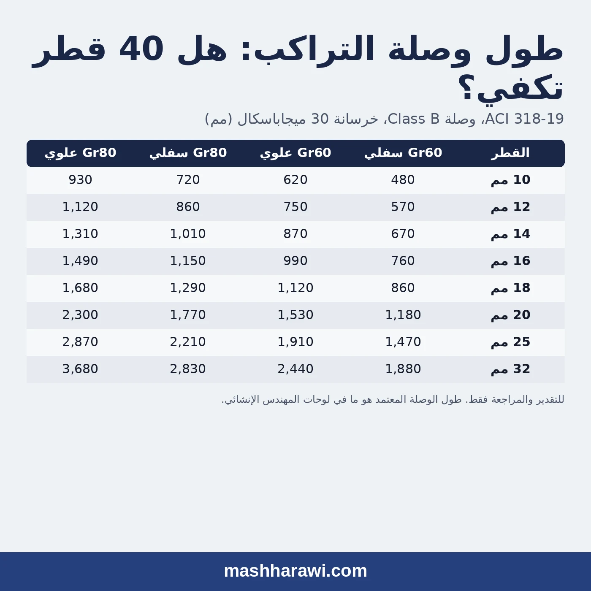

السيخ طوله 12 متراً، والكمرة أو البلاطة أطول من ذلك في أغلب المشاريع. لذلك يُركَّب سيخ فوق سيخ لمسافة معينة حتى تنتقل القوة من الأول إلى الثاني عبر الخرسانة. هذه المسافة هي طول وصلة التراكب (Lap Splice). وفي كثير من المواقع تُكتب قاعدة ثابتة مثل "40 قطر" لكل الأقطار، بينما الكود يعطي أرقاماً تتغير مع القطر ودرجة الحديد ومكان السيخ.

{: style="filter:none;height:auto" width="1400" height="1400" loading="lazy"}

## كيف يُحسب طول الوصلة؟

ACI 318-19، وعليه يعتمد الكود السعودي SBC 304، يحسب أولاً **طول التثبيت** (Development Length) ثم يضربه في معامل حسب نوع الوصلة:

- **وصلة Class B:** 1.3 × طول التثبيت. هذه الحالة العادية.
- **وصلة Class A:** 1.0 × طول التثبيت، ويُسمح بها فقط إذا كان الحديد الموجود ضعف المطلوب على طول الوصلة، ولم يُوصَل أكثر من نصف الأسياخ في نفس المكان.
- **الحد الأدنى:** 300 مم في كل الأحوال.

وطول التثبيت بالمعادلة المبسطة (Table 25.4.2.3) للخرسانة العادية والحديد غير المطلي:

- للأقطار الصغيرة: ld = fy × ψt × ψg ÷ (2.1 × √f'c) × القطر
- للأقطار الكبيرة: ld = fy × ψt × ψg ÷ (1.7 × √f'c) × القطر

حيث:

- **fy:** إجهاد الخضوع، 420 ميجاباسكال لحديد Grade 60، و550 لحديد Grade 80.
- **ψg (معامل الدرجة):** 1.0 لـ Grade 60، و1.15 لـ Grade 80. هذا المعامل أضافه إصدار ACI 318-19.
- **ψt (معامل الأسياخ العلوية):** 1.3 إذا كان تحت السيخ أكثر من 300 مم من الخرسانة المصبوبة معه، و1.0 لغير ذلك.
- **f'c:** مقاومة الخرسانة، وفي الجدول التالي 30 ميجاباسكال.

## جدول طول الوصلة (Class B، خرسانة 30 ميجاباسكال، بالمليمتر)

| القطر | Grade 60 سفلي | Grade 60 علوي | Grade 80 سفلي | Grade 80 علوي |
|---|---|---|---|---|
| 10 مم | 480 | 620 | 720 | 930 |
| 12 مم | 570 | 750 | 860 | 1,120 |
| 14 مم | 670 | 870 | 1,010 | 1,310 |
| 16 مم | 760 | 990 | 1,150 | 1,490 |
| 18 مم | 860 | 1,120 | 1,290 | 1,680 |
| 20 مم | 1,180 | 1,530 | 1,770 | 2,300 |
| 25 مم | 1,470 | 1,910 | 2,210 | 2,870 |
| 32 مم | 1,880 | 2,440 | 2,830 | 3,680 |

الأرقام مقرّبة لأعلى إلى أقرب 10 مم. وضعت قطر 20 مم مع الأقطار الكبيرة لأنه أكبر من الحد الفاصل في الكود (No. 19، أي 19 مم تقريباً)، وهذا الاختيار في جانب الأمان.

## ثلاث ملاحظات من الجدول

**1. قاعدة "40 قطر" لا تكفي حسب هذه المعادلة.** حتى في أفضل حالة (Grade 60، سيخ سفلي، أقطار صغيرة) الوصلة حوالي 48 قطراً. وللأقطار من 20 مم فأكبر تصل إلى حوالي 59 قطراً للسيخ السفلي و76 قطراً للعلوي.

**2. Grade 80 يطيل الوصلة حوالي 50%.** السبب أمران معاً: إجهاد الخضوع أعلى (550 بدل 420)، ومعامل الدرجة 1.15. النتيجة: سيخ 25 مم علوي من Grade 80 يحتاج وصلة 2.87 متر. لذلك يلجأ المصممون أحياناً إلى الوصلات الميكانيكية (Couplers) في الأقطار الكبيرة من Grade 80. وفي Grade 80 يشترط الكود أيضاً حداً أدنى من الكانات حول الوصلة إذا كانت الأسياخ متقاربة.

**3. السيخ العلوي أطول وصلة بـ 30%.** الخرسانة تحت السيخ العلوي تنضح الماء وتهبط قليلاً قبل أن تتصلب، فيضعف التماسك تحته. لذلك وصلة حديد السقف العلوي أو الكمرة العلوية أطول من السفلي بنفس القطر.

## متى تختلف الأرقام عن الجدول؟

- **المعادلة المبسطة لها شروط:** غطاء خرساني لا يقل عن قطر السيخ، ومسافة صافية بين الأسياخ لا تقل عن قطر السيخ مع كانات بالحد الأدنى، أو مسافة صافية لا تقل عن قطرين. إذا لم تتحقق، يزيد الطول حوالي 50%.
- **المعادلة التفصيلية (25.4.2.4)** تأخذ الغطاء والكانات بالحساب، وقد تعطي المصمم وصلة أقصر من الجدول.
- **الحديد المطلي بالإيبوكسي** يحتاج وصلة أطول. شرحت ذلك في [حديد الإيبوكسي في السعودية](/writing/epoxy-coated-rebar-saudi/).
- **وصلات الضغط في الأعمدة** تُحسب بمعادلة أخرى أقصر: حوالي 30 قطراً لحديد Grade 60، و47.5 قطراً لحديد Grade 80، وألا تقل عن 300 مم.
- **الأسياخ الأكبر من 36 مم** لا يُسمح فيها بوصلات التراكب أصلاً.

## كم تضيف الوصلات إلى الطنّية؟

كل وصلة تأكل جزءاً من السيخ. في امتداد طويل مستمر:

- **سيخ 16 مم Grade 60 سفلي:** وصلة 760 مم من كل سيخ 12 متر، أي أن كل سيخ يغطي 11.24 متر فقط. زيادة حوالي **6.8%** في الحديد.
- **سيخ 25 مم Grade 60 سفلي:** وصلة 1,470 مم، أي أن كل سيخ يغطي 10.53 متر. زيادة حوالي **14%**.

هذه الزيادة يجب أن تكون في جدول التفريد وفي طلبية الحديد من البداية. إذا حُسبت الكمية من الأطوال الصافية فقط، سيظهر النقص في الموقع بعد التوريد. وطريقة حساب الكمية خطوة بخطوة في [كمية حديد السقف](/writing/slab-rebar-quantity/).

## الخلاصة للموقع والمشتريات

- طول الوصلة يحدده المهندس الإنشائي في اللوحات والمواصفات، وهو المرجع. هذا الجدول للفهم والتقدير السريع والمراجعة، لا بديلاً عن التصميم.
- لا تستبدل Grade 60 بحديد Grade 80 في الموقع، ولا العكس، بدون موافقة المصمم. تغيير الدرجة يغيّر طول الوصلة أيضاً.
- راجع أطوال الوصلات في جدول التفريد قبل طلب الحديد، خصوصاً في الأقطار 20 مم فأكبر.
- لا تجمع الوصلات في مقطع واحد إلا إذا سمحت اللوحات بذلك.

الوصلة القصيرة لا تظهر وقت الصب. تظهر حين يصل الحمل إليها.
