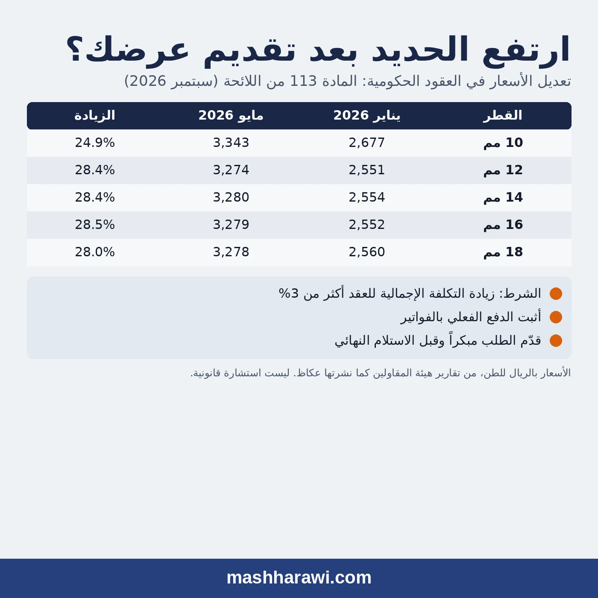

أكثر ما يبحث عنه المقاول عن الحديد هو سعره. والسبب واضح: الحديد من أكبر بنود التكلفة في أي مشروع خرساني، والسعر في يوم تقديم العرض قد لا يكون السعر في يوم الشراء. في 2026 كان هذا الفرق كبيراً. والسؤال الذي يهم المقاول الحكومي: هل يمكن استرداد جزء من الفرق؟ وما المطلوب منه لكي يكون طلبه مقبولاً؟

هذا المقال للتوعية العملية، وليس استشارة قانونية. النص الرسمي وشروط عقدك هي المرجع.

{: style="filter:none;height:auto" width="1600" height="893"}

## كم ارتفع الحديد في 2026؟

حسب تقارير هيئة المقاولين التي اطلعت عليها صحيفة عكاظ في يونيو 2026، ارتفعت أسعار حديد التسليح بين يناير ومايو 2026 بنسب بين 24.9% و28.5%:

| القطر | يناير 2026 (ريال/طن) | مايو 2026 (ريال/طن) | الزيادة |
|---|---|---|---|
| 10 مم | 2,676.99 | 3,343.12 | 24.88% |
| 12 مم | 2,550.66 | 3,274.10 | 28.36% |
| 14 مم | 2,554.23 | 3,279.69 | 28.40% |
| 16 مم | 2,551.54 | 3,278.83 | 28.50% |
| 18 مم | 2,560.35 | 3,278.37 | 28.04% |

مقاول قدّم عرضه في يناير على سعر 2,550 ريال للطن، واشترى الحديد في مايو، دفع حوالي 725 ريالاً زيادة في كل طن.

{: style="filter:none;height:auto" width="1400" height="1400" loading="lazy"}

## ما الذي يقوله النظام؟

المادة (68) من نظام المنافسات والمشتريات الحكومية تسمح بتعديل أسعار العقد. والمادة (113) من اللائحة التنفيذية تشرح التطبيق، وقد نُشر تعديلها في جريدة أم القرى في 25 سبتمبر 2026. أهم ما فيها:

- **التعديل في الاتجاهين.** تُعدَّل الأسعار بالزيادة أو النقص إذا تغيرت أسعار المواد أو الخدمات أو بنود العقد بعد تاريخ تقديم العرض. وإذا انخفض السعر يُخصم الفرق من المقاول، إلا إذا أثبت أنه اشترى بالسعر الأعلى قبل الانخفاض.
- **عقود هامش الربح المحدد مستثناة.**
- **شرط الـ 3%.** في تغيّر أسعار المواد يجب أن ترتفع التكلفة الإجمالية للعقد بأكثر من 3%. أما تغيّر الرسوم والضرائب والتعرفة الجمركية فيُعوَّض بقيمته دون هذا الشرط.
- **الإثبات بالدفع الفعلي.** على المقاول أن يثبت أنه دفع أسعار المواد المخصصة لأعمال العقد بالسعر المرتفع.
- **التوقيت.** لا يُقبل التعديل إذا حصل تغير السعر بعد انتهاء المدة المحددة لتنفيذ العقد، أو إذا تحمّل المقاول الزيادة بسبب تأخره هو، إلا إذا أثبت أن التأخير لسبب خارج عنه.

## كيف يُحسب الفرق؟

الفرق هو سعر البند وقت تقديم العرض مقابل سعره الفعلي وقت التنفيذ. والجهة الحكومية تعيد تسعير البنود المتأثرة من مصادر مرتبة، منها:

- الأسعار المرجعية الرسمية من الجهات المختصة.
- متوسط السعر السنوي للمادة في نشرات الهيئة العامة للإحصاء.
- الأسعار السائدة في السوق.
- أسعار سابقة دفعتها الجهة أو جهات حكومية أخرى في أعمال مشابهة.

**معنى ذلك للمقاول:** فاتورتك ليست وحدها المقياس. إذا اشتريت بسعر أعلى بكثير من نشرة الهيئة العامة للإحصاء أو من سعر السوق، فقد لا يُعترف إلا بجزء من الفرق. السعر الموثق من مصنع معروف أقوى من سعر وسيط بلا مستندات.

## مثال: هل يتجاوز مشروعك حد الـ 3%؟

مشروع حكومي قيمته 20 مليون ريال، يحتاج 1,000 طن حديد تسليح:

- سعر الحديد في العرض: 2,550 ريال للطن
- سعر الشراء الفعلي: 3,280 ريال للطن
- الفرق: 730 × 1,000 = **730,000 ريال**
- نسبته من قيمة العقد: 730,000 ÷ 20,000,000 = **3.65%**، أي فوق حد الـ 3%.

المثال مبسط ويفترض أن باقي البنود لم تتغير. لو كان المشروع نفسه بقيمة 30 مليون ريال، لكانت النسبة 2.4% فقط، ولا يتحقق شرط الـ 3% من الحديد وحده. لذلك احسب نسبة الحديد من قيمة عقدك قبل أن تبني على التعويض.

## خطوات الطلب والمدد

1. يقدّم المقاول طلبه مع المستندات إلى الاستشاري، أو إلى الجهة مباشرة إذا لم يكن هناك استشاري، **قبل الاستلام النهائي للأعمال**.
2. يدرس الاستشاري الطلب ويرفع تقريره خلال **15 يوم عمل** من استلامه مكتملاً.
3. تحيله الجهة إلى لجنة فحص العروض أو لجنة الشراء المباشر، وتوصي اللجنة خلال **30 يوم عمل**.
4. يُرفع المحضر المعتمد إلى اللجنة المختصة بطلبات تعديل الأسعار (المادة 86)، وتبت فيه خلال **45 يوماً** من استلامه مكتملاً.
5. تدفع الجهة الحكومية قيمة التعديل مباشرة.

ولا تُقبل مطالبات التعويض أو تعديل الأسعار خارج ما نصت عليه المادة (68).

**لا تنتظر نهاية المشروع.** قائمة المستندات التي تطلبها اللجنة على موقع وزارة المالية تتضمن ما يثبت أن المقاول تقدّم إلى الاستشاري أو الجهة **خلال 60 يوماً من حدوث ارتفاع الأسعار**. تأكد من المدة التي تنطبق على عقدك، وقدّم طلبك مبكراً.

## المستندات: ابدأ بحفظها من يوم الشراء

أغلب الطلبات تضعف لأن المستندات لم تُجمع وقتها. احفظ لكل شحنة حديد:

- **عرض السعر الذي بنيت عليه عرضك** للمنافسة، بتاريخه.
- **أمر الشراء وعرض سعر المورد وقت الشراء.**
- **الفواتير الضريبية** وإثبات الدفع.
- **مذكرات التسليم** التي تربط الكمية بالمشروع نفسه.
- **شهادات المصنع** التي تثبت أن الحديد المورد مطابق للمواصفة.
- **جدول الكميات وجداول التفريد** التي تثبت أن الكمية المشتراة هي كمية المشروع.
- **نشرة الهيئة العامة للإحصاء** للشهر الذي قدمت فيه العرض والشهر الذي اشتريت فيه.

اربط كل فاتورة بالمشروع برقمه واسمه. الحديد المشترى لعدة مشاريع على فاتورة واحدة يصعب إثبات أنه لهذا العقد بالذات.

## وماذا عن العقود الخاصة؟

المادة 113 تخص العقود الحكومية. في العقود مع القطاع الخاص يحكم العقد نفسه. إذا لم يكن فيه بند لتعديل الأسعار، يتحمل المقاول الزيادة غالباً. لذلك:

- اطلب في العقد بنداً لتعديل سعر الحديد مرتبطاً بمرجع واضح، مثل نشرة الهيئة العامة للإحصاء.
- حدّد مدة سريان عرضك. عرض بلا مدة يعني أنك ضمنت السعر إلى أجل غير محدود.
- إذا كانت الكميات واضحة ومؤكدة، فالشراء المبكر يثبّت السعر، لكنه يحتاج سيولة ومكان تخزين مناسب.

## الخلاصة

- ارتفاع الحديد بعد تقديم العرض قد يُعوَّض في العقود الحكومية، لكن بشروط: تجاوز التكلفة الإجمالية 3%، وإثبات الدفع، وعدم التأخر من جهتك.
- المرجع ليس فاتورتك وحدها، بل أيضاً الأسعار الرسمية ونشرات الهيئة العامة للإحصاء وسعر السوق.
- قدّم الطلب مبكراً وقبل الاستلام النهائي، واحفظ المستندات من أول شحنة.

السعر لا تتحكم فيه، لكن المستندات تتحكم فيها من اليوم الأول.

**المصادر:** المادة الثالثة عشرة بعد المائة من اللائحة التنفيذية لنظام المنافسات والمشتريات الحكومية ([أم القرى](https://www.uqn.gov.sa/decisions-and-regulations/4001950))، و[قائمة مستندات طلبات تعديل الأسعار](https://mof.gov.sa/GSTP/Committees/committee86/Pages/RPAR.aspx) على موقع وزارة المالية، و[تقرير عكاظ عن أسعار الحديد يناير إلى مايو 2026](https://www.okaz.com.sa/economy/na/2253770).
