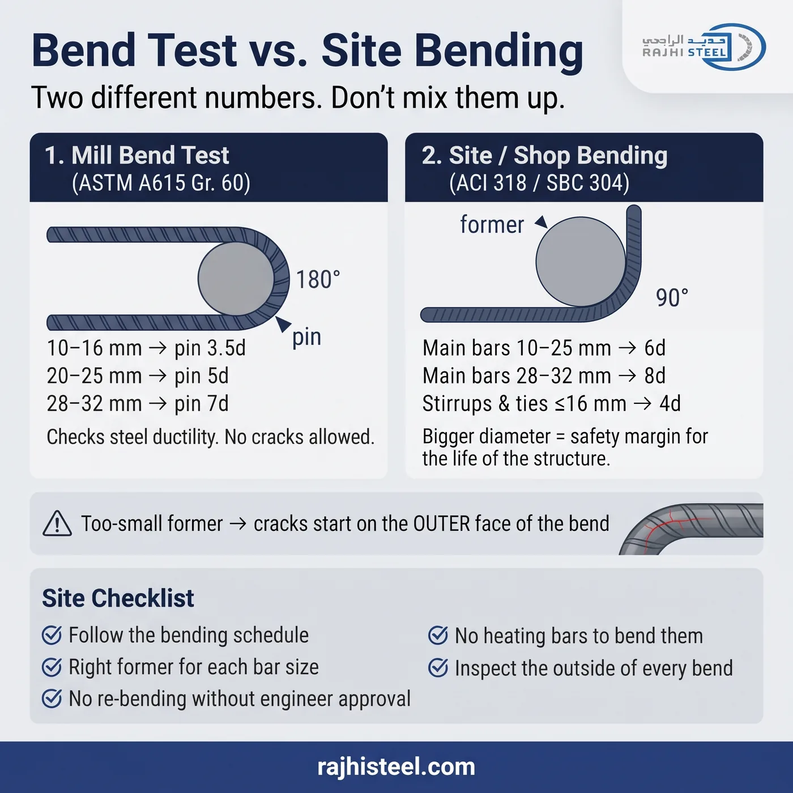

في كثير من المواقع يُسأل السؤال نفسه: شهادة المصنع تقول إن السيخ نجح في اختبار الثني حول مسمار قطره 3.5 مرة قطر السيخ، فلماذا يطلب المهندس في الموقع بكرة قطرها 6 مرات؟ الجواب أن هذين رقمان لغرضين مختلفين، والخلط بينهما من أكثر الأخطاء شيوعاً في ورش القص والثني.

## اختبار الثني في المصنع: فحص لجودة الحديد

اختبار الثني يُجرى على عينة من كل دفعة إنتاج، والهدف منه التأكد من أن الحديد مطيلي (ductile) بما يكفي. تُثنى العينة حول مسمار صغير، ثم يُفحص الوجه الخارجي للثنية: لا يُسمح بأي تشقق.

**حسب ASTM A615 (درجة Grade 60):** تُثنى العينة 180° حول مسمار قطره:

- 3.5 × القطر للأسياخ من 10 إلى 16 مم
- 5 × القطر للأسياخ من 20 إلى 25 مم
- 7 × القطر للأسياخ من 28 إلى 32 مم

وفي درجة Grade 80 يصبح المسمار 5 × القطر للأسياخ الصغيرة أيضاً، لأن الحديد الأعلى مقاومة أقل مطيلية.

**حسب BS 4449 (اختبار إعادة الثني):** تُثنى العينة 90° حول مسمار لا يزيد قطره عن 4 × القطر للأسياخ حتى 16 مم، و7 × القطر لما فوقها، ثم يُعاد ثنيها للخلف 20° على الأقل، ويجب ألا تظهر شقوق.

المهم هنا: هذا اختبار يُجرى مرة واحدة على عينة، ويثبت أن الحديد سليم. وهو لا يعني أن هذا القطر مسموح به في التصنيع.

## الثني في الموقع أو الورشة: ما يطلبه الكود

حين يُثنى السيخ ليُركّب في المنشأ، يطلب الكود قطر ثني داخلي أكبر.

**حسب ACI 318، وعليه يعتمد الكود السعودي SBC 304:**

- 6 × القطر للأسياخ الرئيسية من 10 إلى 25 مم
- 8 × القطر للأسياخ من 28 إلى 36 مم
- 4 × القطر للكانات والأساور حتى 16 مم

**حسب BS 8666:** نصف القطر الداخلي 2 × القطر للأسياخ حتى 16 مم (أي قطر بكرة 4 × القطر)، و3.5 × القطر لما فوقها (قطر بكرة 7 × القطر).

## لماذا قطر الموقع أكبر؟

العينة في المختبر تُثنى ثم تُفحص وتنتهي مهمتها. أما السيخ في الموقع فيبقى في المبنى طوال عمره، ويتحمل الأحمال والاهتزازات وأحياناً الزلازل. لذلك يترك الكود هامش أمان: ثنية أوسع تعني إجهاداً أقل على الوجه الخارجي للسيخ، وتعني أيضاً ضغطاً أقل على الخرسانة داخل الثنية.

وقطر الثني يغيّر طول القص أيضاً، لذلك يجب أن يكون جدول التفريد والبكرة في الماكينة على نفس المواصفة. شرحت ذلك بأمثلة محسوبة في [طول القص بين BS 8666 وACI 318](/writing/bs8666-vs-aci-cut-length/).

## ماذا يحدث مع بكرة أصغر من المطلوب؟

- **الشقوق تبدأ من الخارج.** الوجه الخارجي للثنية يتعرض للشد، وعنده تبدأ الشقوق الدقيقة، خصوصاً عند جذور النتوءات (الضلوع).
- **الشقوق الصغيرة قد لا تُرى بالعين.** السيخ يبدو مثنياً بشكل سليم، لكن الشق قد يكبر لاحقاً تحت الحمل.
- **الخطر أعلى مع Grade 80.** الحديد الأعلى مقاومة أقل تحملاً للثني الحاد.

## قائمة فحص سريعة للموقع

- التزم بجدول التفريد: القطر والشكل وقطر البكرة.
- استخدم البكرة الصحيحة لكل قطر، ولا تستخدم بكرة واحدة لكل المقاسات.
- لا تعِد ثني سيخ أو تعدّله بعد ثنيه إلا بموافقة المهندس.
- لا تسخّن الأسياخ لتسهيل ثنيها إلا بموافقة المهندس وبطريقة معتمدة.
- افحص الوجه الخارجي لكل ثنية قبل التركيب.

السيخ الذي انثنى ليس بالضرورة سيخاً ثُني بشكل صحيح. شهادة المصنع تثبت جودة الحديد، أما سلامة الثنية في المبنى فمسؤولية الورشة والموقع.
