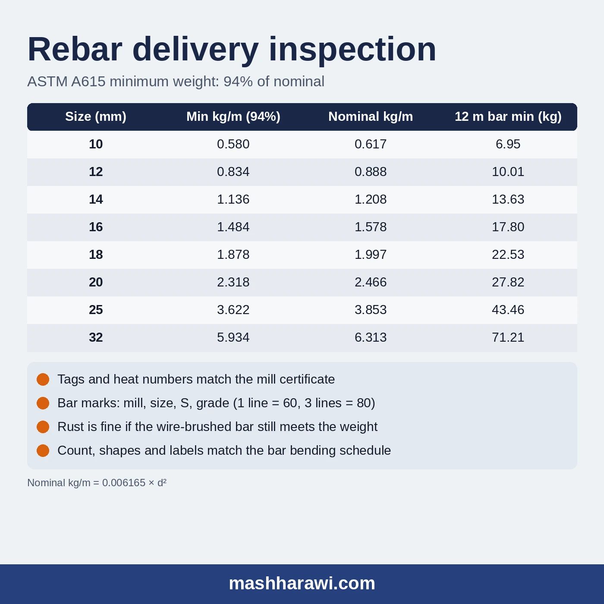

When a rebar truck arrives, check five things before anyone signs the delivery note: the paperwork against the purchase order, the bundle tags against the mill test certificate, the marks rolled on the bars, the weight, and for cut and bent bars, the shapes against the schedule. ASTM A615 accepts a bar that weighs at least 94% of its nominal weight. For 16 mm that is 1.484 kg/m, or 17.80 kg for a 12 m bar.

{: style="filter:none"}

## Before the truck arrives

Most receiving problems start in the office, not at the gate. Have three documents on site before the delivery:

- **The approved material submittal.** On most Saudi projects the consultant approves the rebar source, the standard and the grade before any steel comes to site. The storekeeper should know what was approved.
- **The purchase order or delivery schedule.** Sizes, grade, quantities and whether the bars are straight 12 m or cut and bent.
- **The bar bending schedule**, if the order is cut and bent. Without it nobody on site can check shapes or bundle labels.

## Step 1: paperwork

Compare the delivery note with the purchase order line by line:

- Sizes and quantities, in pieces or tonnes.
- Grade: Grade 60 or Grade 80.
- Standard: usually ASTM A615 in Saudi specifications.
- Coating, if the order is epoxy coated.

Then check that a mill test certificate covers what is on the truck. Every bundle carries a tag with the heat number, size and grade. The heat number on the tag should appear on the certificate, with the results for that heat. If it does not, sort it out while the truck is still on site.

## Step 2: bar marks

ASTM A615 bars carry rolled marks in a fixed order:

1. A letter or symbol for the **producing mill**.
2. The **bar size**.
3. The **type of steel**: "S" for carbon steel to A615.
4. The **grade**: a number, or longitudinal grade lines. One line means Grade 60 and three lines mean Grade 80.

Keep the mill's marking guide with the approved submittal and compare a few bars from each bundle. The marks should agree with the tag, and the tag with the certificate. On a site with both grades, the marks are what keep them apart.

## Step 3: weight

You cannot measure a deformed bar's diameter with a calliper and get a useful answer, because the ribs get in the way. The practical check is weight.

ASTM A615 evaluates deformed bars on nominal weight. A test specimen must weigh **at least 94% of the nominal weight per metre**. Being overweight is never a reason to reject a bar. Nominal weight per metre is 0.006165 × d², with d in millimetres.

| Size (mm) | Nominal (kg/m) | Minimum, 94% (kg/m) | Minimum per 12 m bar (kg) |
|---|---|---|---|
| 10 | 0.617 | 0.580 | 6.95 |
| 12 | 0.888 | 0.834 | 10.01 |
| 14 | 1.208 | 1.136 | 13.63 |
| 16 | 1.578 | 1.484 | 17.80 |
| 18 | 1.997 | 1.878 | 22.53 |
| 20 | 2.466 | 2.318 | 27.82 |
| 25 | 3.853 | 3.622 | 43.46 |
| 32 | 6.313 | 5.934 | 71.21 |

How to use it on site: cut a 1 m piece, or weigh a full 12 m bar on a calibrated scale, and divide by the nominal weight.

- A 1 m piece of 16 mm that weighs 1.52 kg is at 96.3% of nominal. It passes.
- A 12 m bar of 20 mm that weighs 28.9 kg is at 97.7%. It passes.
- The same 20 mm bar at 27.5 kg is at 92.9%. It is below 94%, so hold the heat and ask for a check.

A site scale is a screening test, not a lab result. If one bar looks light, weigh more bars from the same heat before you raise a non-conformance. The full nominal table is in the [rebar weight table](/writing/rebar-weight-table/), and the [weight tolerance note](/writing/weight-tolerance/) explains why the same band also matters for the invoice.

## Step 4: surface condition

ASTM A615 says rust, seams, surface irregularities and mill scale are not a reason for rejection, provided a hand wire-brushed specimen still meets the weight, dimensions, cross-section and tensile requirements.

So light, even surface rust from storage is normal. What deserves a closer look:

- **Loose, flaking scale or deep pitting.** Wire-brush a piece and weigh it.
- **Cracks** at the outside of bends on cut and bent bars.
- **Oil, grease, paint or mud.** These reduce bond and must be cleaned off before the pour, whatever the standard says about rust.
- **Damaged coating** on epoxy-coated bars. The limits and the repair method are in the [epoxy-coated rebar note](/writing/epoxy-coated-rebar-saudi/).

## Step 5: cut and bent bars

For cut and bent deliveries, check against the bar bending schedule:

- Each bundle label shows the bar mark, size, shape and count, and matches a line in the schedule.
- Count the pieces in a few bundles.
- Measure a sample of each shape with a tape against the schedule dimensions, and check the result against the tolerances in your project specification.

A shape that is wrong is cheaper to return than to rebend on site, and some bars, like epoxy bars coated after bending, must not be rebent at all.

## After acceptance

- Unload with slings, do not drop or drag bundles.
- Store on timber, off the ground, sorted by size and grade with the tags facing out.
- Record the heat numbers against the area where the steel is used, if the project asks for traceability.

## Frequently asked questions

### What is the minimum weight of rebar under ASTM A615?

A test specimen must weigh at least 94% of the nominal weight per metre. For 12 mm that is 0.834 kg/m, for 16 mm 1.484 kg/m, and for 32 mm 5.934 kg/m. There is no upper limit: overweight is not a reason for rejection.

### Is rusty rebar acceptable on site?

Yes, if a wire-brushed piece still meets the weight, dimensions and tensile requirements of the standard. Loose scale, pitting, oil and mud are a different matter and should be checked or cleaned before the pour.

### How do I check the rebar grade on site?

Read the rolled marks on the bar. After the mill symbol, size and "S", A615 bars show the grade as a number or as grade lines: one line for Grade 60, three lines for Grade 80. The marks should match the bundle tag and the mill test certificate.

### How often does the mill test rebar?

ASTM A615 requires one tension test and one bend test for each bar size rolled from each heat, plus one set of weight and deformation checks. The results for each heat are on the mill test certificate. Many projects also ask for independent tests on site samples.

## What to send for a quotation

To get a quick quotation, send:

- Sizes and tonnage, or the bar bending schedule.
- Grade 60 or Grade 80, and the standard named in the specification.
- Straight 12 m bars or cut to length, and whether epoxy coating is needed.
- The delivery city and the required date.

Al Rajhi Steel supplies rebar in 10, 12, 14, 16, 18, 20, 25 and 32 mm, Grade 60 and Grade 80, in 12 m bars or cut to length, with all test certificates, from mills in Riyadh and Jeddah to every region of Saudi Arabia. See the [rebar supply page](/rebar/) for details.
