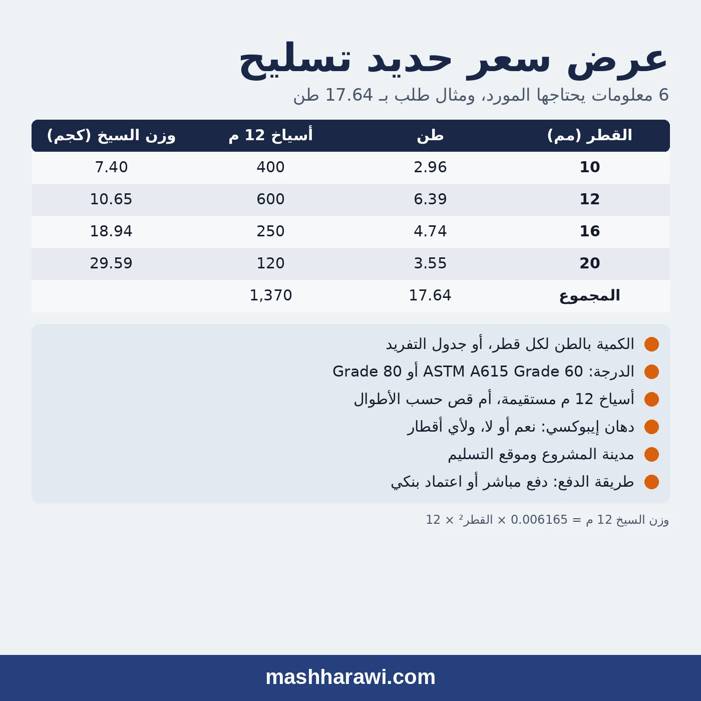

لتحصل على عرض سعر حديد تسليح دقيق من أول رسالة، أرسل للمورد 6 معلومات: **الكمية بالطن لكل قطر** (أو جدول التفريد)، **الدرجة** (Grade 60 أو Grade 80)، **أسياخ 12 م أم قص حسب الأطوال**، **هل تحتاج إيبوكسي**، **مدينة المشروع وموقع التسليم**، و**طريقة الدفع** (دفع مباشر أو اعتماد بنكي). مثال: 400 سيخ 10 مم و600 سيخ 12 مم و250 سيخ 16 مم و120 سيخ 20 مم بطول 12 م تساوي حوالي **17.64 طناً**.

{: style="filter:none;height:auto" width="1400" height="1400" loading="lazy"}

أغلب الطلبات التي تصلني تبدأ بسؤال واحد: "كم سعر الطن؟". والجواب الصادق أن سعر الطن وحده لا يكفي لتقارن أو تقرر، لأن السعر النهائي يتغير مع القطر والدرجة والقص والتوصيل وطريقة الدفع. كل معلومة ناقصة تعني رسالة ذهاباً وإياباً، ويوماً إضافياً قبل أن يصلك العرض.

## 1. الكمية لكل قطر، لا الطنّية الإجمالية

"أحتاج 50 طن حديد" لا تكفي للتسعير. سعر الطن قد يختلف من قطر إلى آخر، والمورد يحتاج الكمية لكل قطر ليجهّز الطلب والشحن. لذلك اكتب الكمية لكل قطر على حدة.

إذا كان عندك عدد الأسياخ من جدول التفريد، حوّله إلى أطنان بوزن السيخ 12 م:

| القطر (مم) | عدد الأسياخ 12 م | وزن السيخ (كجم) | الوزن (كجم) |
|---|---|---|---|
| 10 | 400 | 7.40 | 2,960 |
| 12 | 600 | 10.65 | 6,390 |
| 16 | 250 | 18.94 | 4,735 |
| 20 | 120 | 29.59 | 3,551 |
| **المجموع** | **1,370** | | **17,636 ≈ 17.64 طن** |

وزن السيخ = 0.006165 × القطر² × 12. وللتحويل في الاتجاه العكسي (من الطن إلى عدد الأسياخ) راجع [جدول عدد الأسياخ في الطن](/writing/bars-per-tonne/)، أو احسب مباشرة في [حاسبة وزن حديد التسليح](/ar/tools/rebar-weight/).

المقاسات المتوفرة لدينا: 10، 12، 14، 16، 18، 20، 25، 32 مم بطول 12 متراً. إذا كان في مخططك قطر آخر، اذكره ليُراجع قبل التسعير.

## 2. الدرجة والمواصفة

اكتب الدرجة كما هي في المخطط والعقد، مثل **ASTM A615 Grade 60** أو **Grade 80**. الفرق ليس شكلياً: أقل إجهاد خضوع 420 MPa للدرجة 60 و550 MPa للدرجة 80، وأطوال التراكب وعدد الأسياخ في التصميم محسوبة على الدرجة المكتوبة. لا تطلب درجة غير المكتوبة في المخطط دون موافقة المصمم كتابياً.

وإذا كانت المخططات تطلب حديداً بمواصفة أخرى، مثل ASTM A706 القابل للحام، فاذكر ذلك صراحة في الطلب.

## 3. أسياخ 12 متراً أم قص حسب جدول التفريد؟

حدد أحد خيارين:

- **أسياخ مستقيمة 12 م:** تقص وتثني في الموقع بنفسك.
- **قص حسب المقاسات:** أرسل جدول التفريد (BBS) كاملاً بالأطوال والأعداد وأشكال الثني، ليُؤكد ما يمكن تنفيذه قبل التسعير.

لماذا يهم جدول التفريد الكامل وليس قائمة الأطوال فقط؟ لأن القص يُخطط على السيخ 12 م. سيخ طوله 4.2 م إذا قُص وحده يعطي قطعتين من كل سيخ ويبقى **3.6 م هالكاً، أي 30%** من السيخ. أما إذا رُتّب مع أطوال أخرى من نفس القطر في الجدول، فيمكن استغلال الباقي. ولتجهيز الجدول وخطة القص قبل الطلب استخدم [أداة RebarPlan](/ar/tools/rebarplan/).

## 4. هل تحتاج دهان إيبوكسي؟

الإيبوكسي يُطلب عادةً في البيئات الساحلية والعناصر المعرضة للأملاح والرطوبة، ويكون مكتوباً في المواصفات الفنية للمشروع. اذكر الأقطار والكميات التي تحتاج إيبوكسي منفصلة عن الحديد العادي، لأن تسعيرها مختلف.

## 5. مدينة المشروع وموقع التسليم

الشحن متاح لجميع مناطق المملكة، والمسافة جزء من التكلفة. لذلك اكتب:

- **المدينة والحي**، ويُفضّل موقع المشروع على الخريطة.
- **هل الموقع يستقبل شاحنة كبيرة**، أو يحتاج ترتيباً خاصاً للدخول والتنزيل.
- **هل تريد السعر تسليم الموقع أم من المصنع أو الفرع.**

للراجحي للحديد مصنعان في الرياض وجدة، وفروع في الرياض وجدة والقصيم والطائف.

## 6. طريقة الدفع

دفع مباشر أم اعتماد بنكي (اعتماد مستندي)؟ طريقة الدفع تؤثر على العرض وعلى موعد البدء: التوريد بعد تأكيد الدفع أو اعتماد الاعتماد المستندي (LC)، وفق إجراءات الشركة وتوفر المنتج وجدول التسليم المتفق عليه. إذا كان الشراء باعتماد، فاطلب من المورد البيانات التي يجب أن تُكتب في وصف البضاعة قبل فتحه، حتى لا تتأخر المستندات.

## ما الذي تطلبه أنت في العرض؟

العرض الجيد لا يحتوي سعراً فقط. اطلب أن يوضح:

1. **السعر لكل قطر** وليس متوسطاً واحداً.
2. **شامل ضريبة القيمة المضافة أم لا.**
3. **شامل التوصيل أم لا**، وإلى أي موقع.
4. **صلاحية العرض بالتاريخ**، لأن سعر الحديد يتغير مع السوق.
5. **الشهادات:** شهادة المصنع (Mill Test Certificate) لكل صبة، لتقدمها للاستشاري في اعتماد المواد. جميع شهادات الفحص متوفرة لحديدنا.

## نموذج رسالة جاهز

انسخ هذا النموذج وعدّل الأرقام:

> السلام عليكم، أطلب عرض سعر حديد تسليح:
>
> - الكميات: 10 مم 3 طن، 12 مم 6.4 طن، 16 مم 4.8 طن، 20 مم 3.6 طن (جدول التفريد مرفق).
> - المواصفة: ASTM A615 Grade 60.
> - القص: حسب جدول التفريد المرفق.
> - الإيبوكسي: لا.
> - التسليم: الرياض، حي ...، موقع المشروع مرفق.
> - الدفع: دفع مباشر.
> - المطلوب: السعر لكل قطر، شامل الضريبة والتوصيل، مع صلاحية العرض وشهادات المصنع.

لاحظ أن الكميات في النموذج مقرّبة للأعلى من أرقام المثال (17.64 طن). القرار في التقريب لك، والفائض الصغير أرخص غالباً من شحنة ناقصة تؤخر الصب.

## أسئلة متكررة

### هل يمكن طلب حديد التسليح مقصوصاً حسب جدول التفريد؟

نعم. القص حسب المقاسات المطلوبة متاح. أرسل جدول التفريد كاملاً مع طلب السعر، واذكر أشكال الثني ليتم تأكيدها قبل التسعير.

### هل تتوفر شهادات الفحص مع حديد التسليح؟

نعم، جميع شهادات الفحص متوفرة. اطلبها مع العرض، وعند الاستلام طابق رقم الصبة على بطاقة الحزمة مع رقمها في الشهادة.

### متى يبدأ تسليم الحديد بعد الطلب؟

التوريد بعد تأكيد الدفع أو اعتماد الاعتماد المستندي (LC)، وفق إجراءات الشركة وتوفر المنتج وجدول التسليم المتفق عليه.

### هل أطلب الحديد بالطن أم بعدد الأسياخ؟

الحديد يُسعّر ويُفوتر بالطن، لكن الحساب في الموقع بعدد الأسياخ. احسب الأسياخ من جدول التفريد، ثم حوّلها إلى أطنان لكل قطر كما في الجدول أعلاه، وأرسل الاثنين إن أمكن.

### لماذا لا يوجد سعر ثابت منشور لطن الحديد؟

لأن السعر يتغير مع السوق، ويختلف حسب القطر والكمية والدرجة والقص والإيبوكسي ومدينة التسليم وطريقة الدفع. أي رقم منشور يصبح قديماً بسرعة، والعرض المكتوب بتاريخ صلاحية هو المرجع.

## أرسل طلبك

جهّز الكميات لكل قطر أو جدول التفريد، والدرجة، والقص أو الإيبوكسي إن وُجد، ومدينة التسليم وطريقة الدفع، وأرسلها عبر [صفحة توريد حديد التسليح](/ar/rebar/). كلما كان الطلب كاملاً، وصل عرض السعر أسرع.
