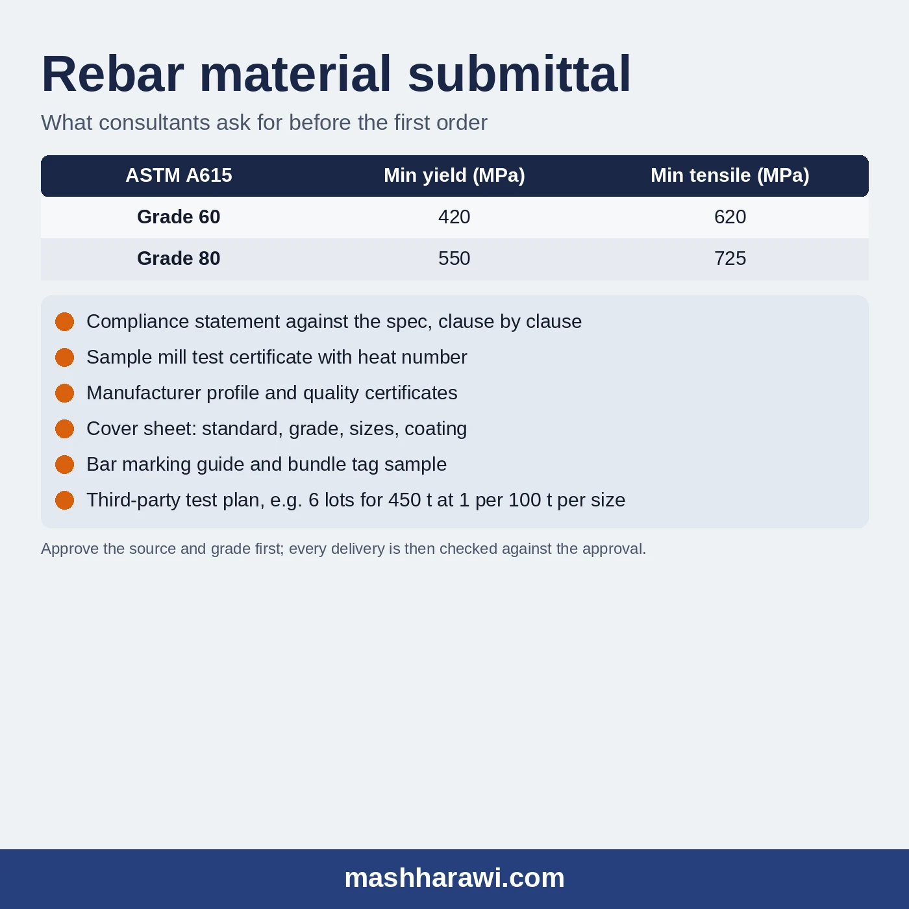

A rebar material submittal on a Saudi project usually holds six things: a cover sheet naming the standard, grade and sizes; a clause-by-clause compliance statement against the specification; the manufacturer's profile and quality certificates; a sample mill test certificate; the bar marking guide; and the testing plan the specification asks for. Get it approved before the first order. For ASTM A615 the grade sets the numbers the consultant checks: Grade 60 means a minimum yield of 420 MPa and tensile of 620 MPa, Grade 80 means 550 MPa and 725 MPa.

{: style="filter:none;height:auto" width="1400" height="1400" loading="lazy"}

## Why the submittal comes first

The consultant approves a source, a standard and a grade. After that, every delivery is checked against what was approved, not against what the site happens to receive. If the submittal is late, the first order waits. If it is vague, every delivery becomes an argument.

So send it early, and send it complete. A rejected submittal costs at least one more review cycle, and the steel cannot be ordered against the specification until it comes back "approved" or "approved as noted".

## What goes in the package

| Item | What it shows | Common reason for rejection |
|---|---|---|
| Cover sheet / transmittal | Spec section, standard, grade, sizes, coating | Grade or standard differs from the specification |
| Compliance statement | Each spec clause, "complies" or a stated deviation | Blanket "complies" with no clause references |
| Manufacturer profile | Who makes the bar, where, what it makes | Trader's profile instead of the mill's |
| Quality certificates | Quality system and product conformity certificates | Expired certificates |
| Sample mill test certificate | Chemistry and mechanical results per heat | No heat number, or a different grade |
| Marking guide and tag sample | How the bars and bundles are identified | Missing, so site cannot check deliveries |
| Test plan | Third-party sampling and the lab | Frequency not taken from the specification |

### Cover sheet

Keep it to one page. Name the specification section for concrete reinforcement, the standard (usually ASTM A615 on Saudi projects), the grade, the sizes you will use and whether any bars are epoxy coated. If the drawings use both Grade 60 and Grade 80, list which elements take which grade.

### Compliance statement

This is the page consultants read first. Copy each requirement from the specification into a table and answer it: standard, grade, sizes, length, marking, testing, coating, storage. Where you cannot comply, say so and propose an alternative. A blanket "we comply with all requirements" is the fastest way to get the package returned.

### Manufacturer profile and certificates

The consultant wants to see the mill that rolls the bar, not only the company that sells it. Include the mill locations, the products, and the quality and product certificates the specification names. Check every expiry date before you submit. Many Saudi specifications also ask for conformity with SASO requirements, and government projects may add local content conditions, so read those clauses and answer them in the compliance statement.

### Sample mill test certificate

Attach a recent certificate for the grade you are submitting. The consultant checks that it reports, for each heat:

- Heat number, size and grade.
- Yield strength, tensile strength and elongation against the ASTM A615 minimums.
- The bend test result.
- Chemical composition.

ASTM A615 requires tension and bend tests on every heat. The certificate is where those results appear, and on site the heat number on each bundle tag is what links the steel to them.

### Marking guide and tag sample

ASTM A615 bars carry rolled marks for the mill, the size, the steel type and the grade. Put the mill's marking guide in the submittal, with a photo or sample of a bundle tag. This is the page your storekeeper will use at the gate. The [delivery inspection checklist](/writing/rebar-delivery-inspection/) shows how it is used when the truck arrives.

### Test plan

Many specifications ask for independent tests on site samples at an approved lab, at a set frequency per size and per quantity. Take the frequency from your specification, not from habit. A worked example, at one test lot per 100 tonnes of each size:

| Size (mm) | Tonnes | Test lots |
|---|---|---|
| 12 | 80 | 1 |
| 16 | 140 | 2 |
| 20 | 160 | 2 |
| 25 | 70 | 1 |
| **Total** | **450** | **6** |

Note the rounding: 140 tonnes is two lots, not 1.4. Budget the tests and the lab time in the programme before the first pour.

## Grade 60 or Grade 80: decide before you submit

The submittal fixes the grade. Changing it later is a design change, not a procurement detail.

| ASTM A615 | Min yield (MPa) | Min tensile (MPa) |
|---|---|---|
| Grade 60 | 420 | 620 |
| Grade 80 | 550 | 725 |

Grade 80 is stronger, but a stronger bar is not automatically a drop-in replacement. In ACI 318, on which the Saudi concrete code SBC 304 is based, development and lap length rise with yield strength. 80 / 60 = 1.33, so the same bar needs about a third more length to develop, and ACI 318-19 adds a further factor for Grade 80. Laps on the drawings may be too short. Any substitution needs the structural engineer's written approval and a revised submittal.

## Coated bars and special items

If the specification calls for epoxy-coated bars in some elements, submit the coating as its own item: the coating standard, the applicator, and the repair material for site damage. The [epoxy-coated rebar note](/writing/epoxy-coated-rebar-saudi/) covers when coating is needed. If the specification has a weight tolerance clause, quote it in the compliance statement and agree whether invoices follow actual or theoretical weight. The [weight tolerance note](/writing/weight-tolerance/) explains why that matters.

## Frequently asked questions

### Which documents go into a rebar material submittal?

A cover sheet, a clause-by-clause compliance statement, the manufacturer's profile and quality certificates, a sample mill test certificate, the bar marking guide with a tag sample, and the testing plan from the specification. Some consultants also ask for a physical sample of each size.

### Does every rebar delivery need its own mill certificate?

Yes, in practice. The submittal approves the source and grade with a sample certificate. Each delivery then needs certificates for the heats on the truck, so the heat numbers on the bundle tags can be matched to test results.

### Can Grade 80 replace Grade 60 after approval?

Only with the structural engineer's written approval and a revised submittal. Development and lap lengths in ACI 318 grow with yield strength: at least a third longer for Grade 80 than Grade 60, and more once the ACI 318-19 Grade 80 factor is applied, so the drawings may need to change.

### How long does a material submittal take to approve?

It depends on the consultant and the contract review period. Plan for at least one full review cycle, and submit before you need to order. A complete compliance statement is the best way to avoid a second cycle.

## What to send for a quotation

Once the submittal is ready, a supplier can quote quickly if you send:

- The approved standard and grade, and the specification clauses on testing and marking.
- Sizes and tonnage, or the bar bending schedule.
- Straight 12 m bars or cut to length, and any epoxy-coated items.
- The delivery city and the required date.

Al Rajhi Steel makes reinforcing steel at mills in Riyadh and Jeddah: 10, 12, 14, 16, 18, 20, 25 and 32 mm, Grade 60 and Grade 80, in 12 m bars or cut to length, with epoxy coating and all test certificates available, shipped to every region of Saudi Arabia. See the [rebar supply page](/rebar/) for details.
